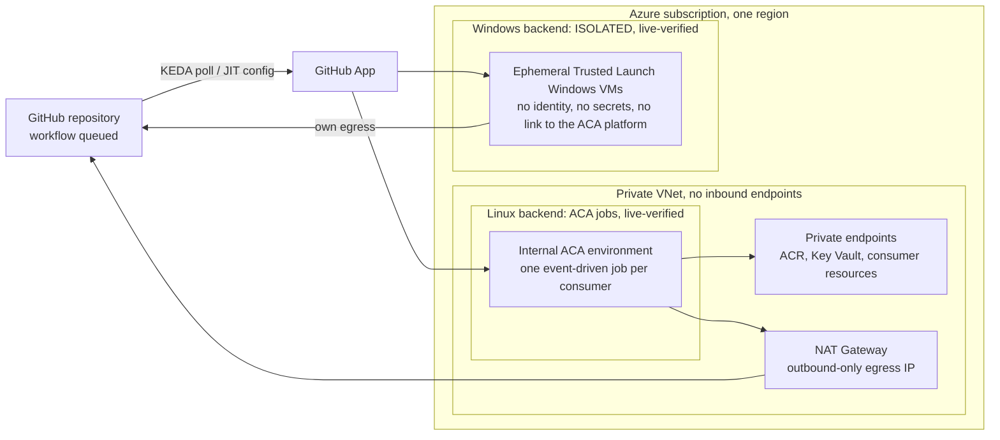

# azure-gh-runners

Ephemeral, private-endpoint-only **self-hosted GitHub Actions runners on Azure**, shared by any repository you
onboard. Built for personal-account GitHub repositories (no GitHub Enterprise Cloud private networking) whose
workflows need to reach Azure resources that have **no public endpoint**.

## Why

GitHub-hosted runners cannot reach private-endpoint-only Azure services, and a personal account has no hosted
private networking. Self-hosted runners solve that, but on public repositories they are risky: anyone who can run a
workflow executes code inside your network. This project makes that tradeoff explicit and constrained:

- Runners are single-use (JIT), run in a private VNet, and have no inbound endpoints.
- A **policy floor** limits what public repositories may trigger, and it is enforced twice: at onboarding (registry
  validation) and on the runner (pre-job hook).
- The job container gets no secrets and no usable managed identity.

## Architecture



- **Linux:** Azure Container Apps jobs in an internal environment, one job per registered consumer, scaling to
  zero. Private ACR Premium and Key Vault. Consumers reach their own private resources through private endpoints in a
  shared subnet.
- **Windows:** one ephemeral Trusted Launch Windows Server 2025 VM per job on a VMSS Flex backend that is deliberately
  separate from the ACA platform, with its own resource group and network, no managed identity and no secrets on the
  worker ([ADR-0007](docs/adr/0007-windows-vmss-isolated-runners.md), [guide](docs/windows-runners.md)). It cannot reach
  your private endpoints. A Linux VMSS backend inside the private network was evaluated and rejected
  ([ADR-0006](docs/adr/0006-vmss-flex-spike.md)).

The approved design is in the [plan](docs/plan.md) and [PRD](docs/prd.md).

## Security model in brief

- Workload PaaS resources have public network access disabled. Log Analytics is the documented exception (standard
  endpoints, local authentication disabled, Azure RBAC). The NAT Gateway IP is the only public IP and is outbound-only.
- Public consumers may run only `workflow_dispatch`, `schedule`, and default-branch `push`. `pull_request_target`
  and `workflow_run` are never allowed. One scoped exception exists for the isolated Windows backend only
  (same-repository pull requests on ephemeral, secretless workers); that path has not been run live, and it does not
  apply to Linux.
- Consumers are onboarded only through `config/consumers/<name>.json`, validated by tooling.
- The GitHub App key lives in Key Vault and is used only by the init and scaling path, never by job steps.
- Deployment goes only through the protected `platform-prod` workflow on `main`.

Self-hosted runners on public repositories carry inherent risk; read [SECURITY.md](SECURITY.md) and the
[security model](docs/security.md) before adopting, and understand the residual risks (shared subnet, privileged
operator credentials).

## Prerequisites

An Azure subscription, a GitHub account with a fork of this repository, Node.js/npm, Azure CLI with Bicep, GitHub
CLI, and PowerShell 7. Details are in [docs/adopting.md](docs/adopting.md).

## Quickstart

Follow **[docs/adopting.md](docs/adopting.md)**: replace the values that are specific to the maintainer, bootstrap the
Azure identities and the GitHub App ([runbooks](docs/runbooks/)), set the environment secrets, run the **Deploy
platform** workflow, and onboard a first consumer.

## Cost

Rough figures, not measured guarantees:

- **Linux fixed baseline: about USD 110 per month** for the network, private endpoints, and ACR Premium. This is
  incurred while the platform exists, even with no jobs running.
- **Linux jobs:** ACA bills per second of vCPU and memory, scaling to zero when idle.
- **Windows:** per job, for the VM time of each ephemeral worker (a `Standard_D4ds_v5` is roughly USD 0.4 per hour).
  The Windows backend also has its own small fixed baseline (network, NAT gateway, ACR, Log Analytics), not measured
  separately.

Tear everything down when you are not using it ([teardown](docs/adopting.md#8-teardown)).

## Status and limitations

| Area | Status |
| --- | --- |
| Linux ACA platform | **Live-verified** in the maintainer's subscription (2026-10-11): staged deploy, private DNS, Entra OIDC to a private resource, scale 0 to 1 to 0, and negative trigger checks. See [smoke.md](docs/smoke.md). |
| Windows isolated backend | **Live-verified once** (2026-10-11): a smoke job ran on an ephemeral Trusted Launch VM as a non-admin account, and the VM, NIC, disk and runner registration were gone afterwards (run 38176888808 (repository since removed)). The `pull_request` exception and the NSG outbound deny rules were not run live. |
| Maintainer's deployment | Torn down after verification (2026-10-11), and the smoke repositories were removed. Nothing is running or costing money. The platform is recreated from this repository with [docs/adopting.md](docs/adopting.md), and [docs/smoke.md](docs/smoke.md) describes the smoke pattern to repeat. |
| Other tenants, regions, organisations | **Not verified.** Only `swedencentral` is supported by the validators and Bicep. |
| Linux VMSS Flex backend | Rejected ([ADR-0006](docs/adr/0006-vmss-flex-spike.md)). |
| Release | v1.0.0. Both backends were deployed through their protected workflows in the maintainer's subscription; this is a lab-grade platform, not a hardened multi-tenant service. |
| Support | Best effort from a single maintainer; see [SECURITY.md](SECURITY.md). |

Other known limits: a fixed baseline cost even when idle, Linux jobs share a subnet, a Windows worker has open
outbound 443 and 80 to the internet, and there is no multi-region or high-availability design. Treat this as a
lab-grade platform for your own repositories, not a hardened multi-tenant service.

## Documentation

| Document | Purpose |
| --- | --- |
| [Adopting](docs/adopting.md) | Fork, configure, deploy, onboard, tear down |
| [PRD](docs/prd.md) | Goals, requirements, security floor, success metrics |
| [Plan](docs/plan.md) | Approved implementation plan and target architecture |
| [Roadmap](docs/roadmap.md) and [backlog](docs/backlog.md) | Milestones, work items, and acceptance criteria |
| [Consumer registry](docs/consumer-registry.md) | Consumer JSON contract, resource limits, validation boundary |
| [Security model](docs/security.md) | Threats, controls, assurance limits, residual risks |
| [Observability](docs/observability.md) | Log Analytics exception and diagnostic-settings contract |
| [Smoke test](docs/smoke.md) | End-to-end evidence and the consumer pattern |
| [Windows runners](docs/windows-runners.md) and [image](docs/windows-image.md) | Isolated Windows backend: operation, deployment, image build |
| [Runner image](image/README.md) | Pinned toolset, local image checks, runtime contracts |
| [Runbooks](docs/runbooks/) | [Identity bootstrap](docs/runbooks/bootstrap-identity.md) and [GitHub App](docs/runbooks/github-app.md) |
| [ADRs](docs/adr/README.md) | Architecture decisions |
| [AGENTS.md](AGENTS.md) | Rules for AI agents (and humans) working in this repo |

Background research: [runner options on Azure](docs/research-azure-runner-options.md) and
[public repo + private-endpoint-only constraints](docs/research-public-repo-private-endpoints.md).

## Local validation

Install Node.js/npm and the [Azure CLI](https://learn.microsoft.com/cli/azure/install-azure-cli) with Bicep.
Hook tests additionally require Bash, git, jq, and curl on Linux, or Linux Docker on Windows. Then run:

```powershell
npm ci
npm run validate
```

`npm run validate` runs consumer schema, registry, and generator tests; validates active `config/consumers/*.json`
entries against GitHub repository visibility and default-branch metadata; checks generated consumer parameters for
drift; builds and lints the Bicep; runs network, observability, and diagnostic-category checks; checks the offline
image contract and executes the policy-hook fixtures; and lints Markdown. The PR workflow
`.github/workflows/validate.yml` runs the same command on GitHub-hosted runners.

Run `npm run generate:consumers` after editing the registry to update `infra/generated/consumers.json`. An empty
registry needs no GitHub access; active entries require GitHub CLI access to each registered repository. Files ending
in `.sample` are examples, not active entries. Validation never deploys resources.

## Contributing and license

Contributions are welcome: see [CONTRIBUTING.md](CONTRIBUTING.md) and the [Code of Conduct](CODE_OF_CONDUCT.md).
Report vulnerabilities privately as described in [SECURITY.md](SECURITY.md). Licensed under the [MIT License](LICENSE).
