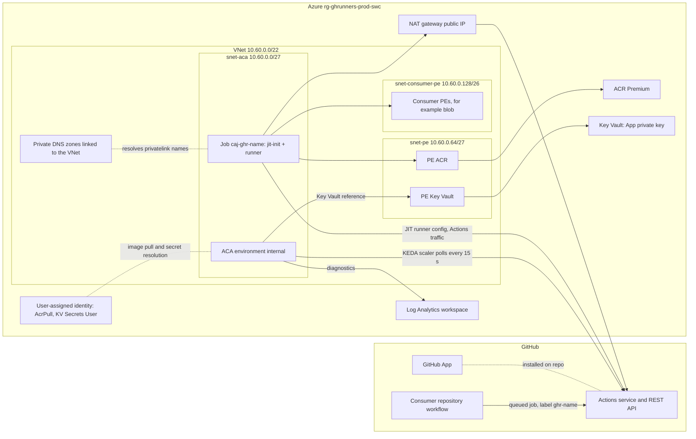
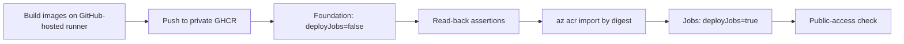

# Architecture

A shared Azure platform that runs ephemeral, private-network GitHub Actions runners for registered repositories.
Linux jobs run on Azure Container Apps (ACA) jobs in one internal, VNet-integrated environment; each job execution
registers a single-use runner, runs one workflow job, and exits. Scale is zero when idle.

Status: the platform is deployed in `rg-ghrunners-prod-swc` (`swedencentral`) and the `ghr-smoke` smoke test passes
([evidence](smoke.md)). Items below marked *not live-verified* are design intent only. Requirements are in the
[PRD](prd.md), the approach in the [plan](plan.md), and decisions in the [ADR index](adr/README.md).

## Components



| Component | Role |
| --- | --- |
| Consumer repository | Queues jobs with `runs-on: ghr-<name>` (one custom label, [ADR-0005](adr/0005-runner-labels.md)). |
| GitHub App | Installed on selected repositories; its key mints the KEDA scaler token and each JIT runner configuration. |
| ACA environment | Internal, workload-profiles (Consumption), `publicNetworkAccess: Disabled`, not zone-redundant (see [operations](operations.md#the-avm-zoneredundant-trap)). |
| ACA job `caj-ghr-<name>` | One per registry entry (`config/consumers/<name>.json`). Event-triggered by the KEDA `github-runner` scaler, `minExecutions: 0`, `parallelism: 1`. |
| `jit-init` init container | Reads the App key, requests a single-use repository JIT configuration, writes it to an `EmptyDir`. |
| `runner` container | Reads and deletes the JIT file, then runs one job. The pre-job hook enforces the consumer policy before user steps. No secret env vars, no usable token. |
| ACR (Premium) | Holds the `jit-init` and `runner` images, imported by digest; private endpoint only. |
| Key Vault | Holds the App private key; RBAC authorization; private endpoint only. |
| Log Analytics | Receives ACA environment logs; the one documented public-endpoint exception ([observability](observability.md)). |
| NAT gateway + public IP | Outbound-only static egress address for `snet-aca`. |
| User-assigned identity | Image pull (`AcrPull`) and Key Vault reference resolution (`Key Vault Secrets User`) only. |

The Windows backend is a separate, isolated platform and is not part of this diagram; see
[Windows runners](#windows-runners).

## Network and DNS flow

- `snet-aca` (delegated to `Microsoft.App/environments`) has a NSG and the NAT gateway. The NSG allows outbound HTTPS to
  `snet-pe` and `snet-consumer-pe`, outbound HTTPS to the internet (egress through the NAT address), and the required
  platform service tags, then denies all other RFC1918 destinations. Inbound is denied except ACA infrastructure
  probes and intra-subnet traffic. See `infra/modules/network.bicep`.
- Six private DNS zones (`privatelink.blob|file|queue|table.core.windows.net`, `privatelink.vaultcore.azure.net`,
  `privatelink.azurecr.io`) are linked to the VNet with registration disabled. A private endpoint's DNS zone group
  writes its `A` record into the matching zone.
- A runner resolving `<account>.blob.core.windows.net` follows the public CNAME to the `privatelink` name and gets a
  `10.60.0.x` address from the zone. This was observed live: the smoke storage account resolved to `10.60.0.132`
  from inside the runner ([smoke run](smoke.md)).
- ACR and Key Vault use `snet-pe`; consumer resources use `snet-consumer-pe`. Both are reachable on 443 from every job:
  the subnets are not a per-consumer boundary ([security](security.md#shared-network-residual-risk-and-escalation)).
- Egress to GitHub goes through the NAT gateway on 443 ([ADR-0003](adr/0003-egress-requirements.md)); there is no
  FQDN allowlist in v1.

## Trust boundaries

| Boundary | Inside | Outside | Control |
| --- | --- | --- | --- |
| Workflow code | Consumer job steps in the `runner` container | Platform credentials | No secret env vars; token requests to the identity endpoint return HTTP 400 ([ADR-0004](adr/0004-runner-secret-isolation.md)). |
| Init vs runner container | `jit-init` (App key) | `runner` (JIT file only) | Separate containers sharing only an `EmptyDir`. |
| Job admission | Events and refs in the consumer policy | Everything else | Registry validator in CI and the runner pre-job hook, both fail closed. |
| Platform deployment | `platform-prod` workflow on `main` | Local checkouts, other workflows | Main-only environment, exact RBAC allowlist ([runbook](runbooks/bootstrap-identity.md)). |
| Consumer data | Consumer-owned Entra identity and RBAC | Other consumers | Network does not separate consumers; service-side RBAC does. |

## Public-exposure statement

- **No inbound workload endpoint.** The ACA environment is internal with public network access disabled; ACR, Key
  Vault and consumer storage have public network access disabled and are reached only through private endpoints.
- **The NAT gateway public IP is the only public IP resource** and is outbound-only.
- **Exception: Log Analytics.** Standard ingestion and query endpoints stay enabled (no AMPLS); local authentication
  is disabled and Azure RBAC governs access ([observability](observability.md)).
- **Enforced automatically.** After every deployment, `tools/check-public-access.mjs` runs read-only against the
  resource group and fails the deploy run on any violation ([operations](operations.md#public-access-check)).
- GitHub itself is reached outbound only. Workflow-code reachability of the internet over 443 is allowed by design.

## Staged deployment

`deploy.yml` (environment `platform-prod`, `main` only) deploys into the existing resource group in stages. Production
deployment from a local checkout is not permitted.



1. Build `jit-init` and `runner` on a GitHub-hosted runner and push to private GHCR
   ([ADR-0001](adr/0001-image-build-path.md)).
2. Deploy the foundation (network, observability, ACA environment, ACR, Key Vault, smoke storage) with `deployJobs=false`.
3. Read back network settings, private endpoints and DNS records.
4. `az acr import` both images into ACR by digest (ACR trusted-services bypass is on).
5. Deploy one ACA job per registry entry with `deployJobs=true`; read back provisioning state, no secret env vars and
   `identitySettings.lifecycle: None`.
6. Run the public-access check.

`foundation_only` stops after step 3 and then runs step 6.

## Secrets flow

```text
GitHub environment secret GH_APP_PRIVATE_KEY (platform-prod)
  -> deploy workflow (secure Bicep parameter)
  -> Key Vault secret github-app-private-key (private endpoint, RBAC)
  -> ACA job secret by Key Vault reference (resolved with the user-assigned identity, ADR-0002)
  -> jit-init init container environment ONLY (and the KEDA scale-rule auth)
  -> single-use JIT config in an EmptyDir -> runner container (key never present)
```

The `runner` container receives only non-secret `CONSUMER_POLICY_JSON`. The identity's `lifecycle: None` setting means
no token is obtainable inside the job. Live evidence: HTTP 400 for both the system-assigned and the user-assigned
identity ([ADR-0004](adr/0004-runner-secret-isolation.md)); this is one run, not a proof of absence.

## Windows runners

ACA cannot run Windows. Windows jobs use a separate, isolated VMSS Flex backend in its own resource group with no
network link to this platform ([ADR-0007](adr/0007-windows-vmss-isolated-runners.md), tracked in
[#93](https://github.com/jonathan-vella/azure-gh-runners/issues/93)). Its design and status are documented there, not
here.

## Decision records

| ADR | Decision |
| --- | --- |
| [0001](adr/0001-image-build-path.md) | GHCR build, `az acr import` by digest |
| [0002](adr/0002-key-vault-secret-references.md) | Key Vault references over private endpoints |
| [0003](adr/0003-egress-requirements.md) | NAT egress, outbound 443 |
| [0004](adr/0004-runner-secret-isolation.md) | Init-container secret isolation |
| [0005](adr/0005-runner-labels.md) | Single custom label `ghr-<name>` |
| [0006](adr/0006-vmss-flex-spike.md) | Linux VMSS Flex rejected |
| [0007](adr/0007-windows-vmss-isolated-runners.md) | Isolated Windows VMSS Flex |
