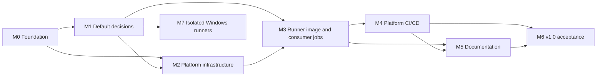

# Roadmap

Milestones are sequential gates. Each one has exit criteria and maps to a GitHub milestone. Work items for each
milestone are listed in the [backlog](backlog.md) and tracked as GitHub issues.

| Milestone | Goal | Exit criteria |
| --- | --- | --- |
| **M0 - Foundation** | Repository, identities, and GitHub App exist; agents can work in the repo. | Branch protection active; layout scaffolded; `AGENTS.md` complete; OIDC credentials and `platform-prod` environment configured; GitHub App created with runbooks. |
| **M1 - Default decisions** | Record v1 decisions without further spikes. | ADR-0001 to ADR-0005 accepted as defaults pending live smoke; ADR-0006 (Linux VMSS Flex) rejected for v1; ADR-0007 (isolated Windows VMSS Flex) accepted as a direction. |
| **M2 - Platform infrastructure** | Private-endpoint-only shared foundation deploys cleanly. | Network, observability, Key Vault, ACR, and internal ACA environment build/lint cleanly and deploy with `deployJobs=false`; no inbound access and NAT-only public IP. |
| **M3 - Runner image and consumer jobs** | Hardened image and registry-driven ACA jobs. | Image imported into ACR by digest; one ACA job per registry entry deploys with `deployJobs=true`; registry accepts only the `aca` backend. |
| **M4 - Platform CI/CD** | The repo runs itself through its protected workflows. | Required PR validation (`validate.yml` running `npm run validate`); main-only `platform-prod` staged deployment (`deploy.yml`) with post-deploy assertions. The weekly maintenance workflow ([#28](https://github.com/jonathan-vella/azure-gh-runners/issues/28)) is deferred: a scheduled deploy would run unattended on the no-reviewer environment. |
| **M5 - Documentation** | An agent can operate and onboard without extra context. | Architecture, onboarding, operations, and security guidance are complete and linked from `AGENTS.md`. |
| **M6 - v1.0 acceptance** | Prove ACA end to end. | A smoke workflow in public `jonathan-vella/ghr-smoke` runs on the real ACA runner and lists an empty blob container (consumer OIDC identity with Storage Blob Data Reader) in a storage account with public network access disabled, reached only through a private endpoint in `snet-consumer-pe`; automated no-public-endpoint check is green; `v1.0.0` tagged. #74 is not a v1.0 dependency. |
| **M7 - Isolated Windows runners** | Ephemeral Windows runners on VMSS Flex, isolated from the ACA platform ([ADR-0007](adr/0007-windows-vmss-isolated-runners.md)). Does not gate v1.0. | `apex-vnext` `windows-package-tests` passes on the Windows runner with wall time and cost recorded against the ~46-minute hosted baseline; workers are ephemeral with no identity or secrets and no link to the ACA platform; fork-PR approval verified; teardown leaves no VMs or registrations. |

## v1 decisions (2026-10-08)

- v1 uses Azure Container Apps jobs only. Deploy directly into the existing empty `rg-ghrunners-prod-swc` through the
  `platform-prod` OIDC workflow: GitHub-hosted image build → private GHCR → foundation (`deployJobs=false`) →
  `az acr import` by digest into ACR (trusted-services bypass on) → jobs (`deployJobs=true`).
- No further spikes. The spike harnesses were removed from the tree and remain in git history (last present at commit [`25c0519`](https://github.com/jonathan-vella/azure-gh-runners/tree/25c0519b2a5cf9bf718091b18d0451b52af79aae)).
- Merge bar: CI build, `npm run validate`, and one agent code review with no blocking findings, then agent merge.

**Historical (superseded):** the dual-backend plan (tracker #59, VMSS issues #60–#72, #81, #84), the D4 evidence rule,
and the Linux VMSS controller design in the private network are superseded by the ACA-only decision for Linux; see
[ADR-0006](adr/0006-vmss-flex-spike.md). Those issues are closed.

## Windows runners (2026-10-11)

ACA cannot run Windows. Windows jobs use a separate, isolated VMSS Flex backend with no link to the ACA platform
([ADR-0007](adr/0007-windows-vmss-isolated-runners.md)); work is milestone M7 in the [backlog](backlog.md), tracked by
[#93](https://github.com/jonathan-vella/azure-gh-runners/issues/93). It does not gate v1.0.

## Status (2026-10-11)

The ACA platform is **deployed and the smoke test passes**. The earlier failures were caused by the AVM
managed-environment module defaulting to `zoneRedundant: true`; #92 set it to `false`. After recreating
`rg-ghrunners-prod-swc` (restoring the deploy identity's two documented roles and purging the stale vault), a
foundation-only deploy and then a full staged deploy succeeded. [ghr-smoke run 38147983595](https://github.com/jonathan-vella/azure-gh-runners/actions/runs/38147983595)
ran on the real ACA runner: the storage hostname resolved to a private address, Entra OIDC login worked, and the
container listing succeeded over the private endpoint. The job scaled back to zero, no runner registration remained, and
ACR, Key Vault and storage have public network access disabled with the NAT public IP as the only public IP.

Documentation (M5, [#29](https://github.com/jonathan-vella/azure-gh-runners/issues/29)–[#32](https://github.com/jonathan-vella/azure-gh-runners/issues/32))
is written: [architecture](architecture.md), [consumer onboarding](onboarding-consumer.md), [operations](operations.md)
and [security](security.md). The automated no-public-endpoint check (`tools/check-public-access.mjs`) is wired into
`npm run validate` and as the last step of `deploy.yml`; its first live result is the next deploy run. The negative
smoke checks are specified in [smoke.md](smoke.md#negative-checks) and have not been run yet. Remaining v1.0 items:
run the negative smoke checks, one deploy with the public-access check green, a cold agent onboarding from the guide
(optional evidence), and the release tag; see [CHANGELOG.md](../CHANGELOG.md). Earlier handoff:
[#34 comment](https://github.com/jonathan-vella/azure-gh-runners/issues/34#issuecomment-6068366703).

## After v1.0 (not scheduled)

- Onboard `apex-vnext` as the first real consumer (separate plan in that repository).
- **Template repository (decided 2026-10-11):** after the final teardown, enable the "Template repository" flag so
  adopters can create a clean private copy (see [`docs/adopting.md`](adopting.md)). Do it after teardown so the evidence
  documents that cite deleted resources do not confuse adopters. A longer-term fix for the config-and-code-in-one-repo
  conflict problem is publishing the Bicep modules and workflows for reuse; not scheduled.
- Optional per-consumer subnet or environment isolation for high-sensitivity consumers.
- Optional additional image variants if consumers need tools beyond the generic set.
- Revisit a Linux VMSS Flex backend in the private network only if ACA proves insufficient ([ADR-0006](adr/0006-vmss-flex-spike.md)).
- Revisit GitHub organization + larger runners with VNet injection if repositories move into an organization.
