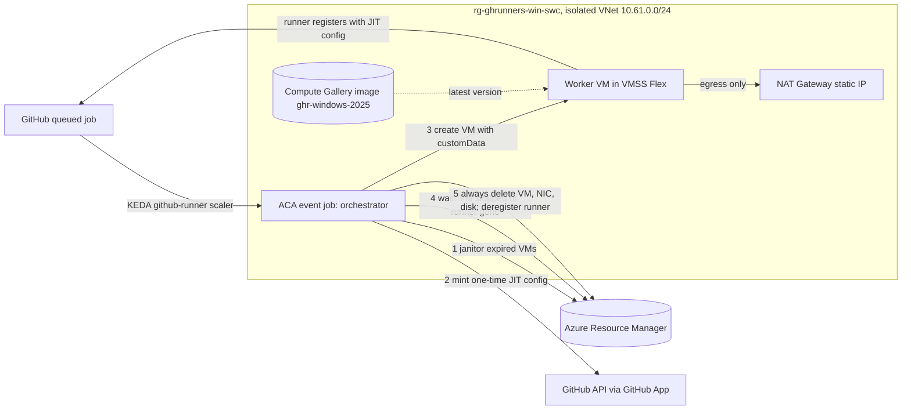

# Isolated Windows runners

Operator and adopter guide for the Windows backend. Decision record:
[ADR-0007](adr/0007-windows-vmss-isolated-runners.md). Tracking issue:
[#93](https://github.com/jonathan-vella/azure-gh-runners/issues/93).

**Status: built, not yet live-verified.** The infrastructure, orchestrator and deployment workflow exist and pass offline
validation. They have not been deployed, and no Windows job has run on them. Nothing here is proof of runtime behavior
until the acceptance run ([#99](https://github.com/jonathan-vella/azure-gh-runners/issues/99)) records it.

## Why a second backend

Azure Container Apps runs only Linux containers, so it cannot run Windows jobs. The Windows backend runs one
short-lived Windows Server 2025 VM per job instead. It is deliberately **not** part of the private-endpoint platform: it
has its own resource group and VNet, reaches only the public internet through a NAT Gateway, and is meant for jobs that
need Windows or speed but no private Azure access.

## Architecture

One orchestrator execution handles one queued job:

1. **Janitor.** Delete any VM, NIC or disk in the resource group that carries the `ghr-managed=true` tag and whose
   `expiresUtc` tag has passed. Resources without the tag, with a missing or unparseable expiry, in another resource
   group, or of another type are never touched.
2. **Mint.** Use the GitHub App to create a one-time, repository-scoped JIT runner configuration for the consumer's
   single custom label. The App key arrives as an ACA secret and is never logged.
3. **Create.** Create one VM from the latest image version in the gallery, in the worker subnet, attached to the VMSS
   Flex. The NIC has no public IP, the VM has no managed identity, and the OS disk is Premium SSD. Tags:
   `ghr-managed=true`, `consumer`, `runId`, `expiresUtc` (now + job timeout + 15 minutes). The JIT configuration, the
   consumer policy and the expiry are passed as UTF-8 JSON in `customData`:
   `{"version":1,"jitConfig":"<base64>","policy":{...},"expiresUtc":"..."}`. A random admin password is generated for
   provisioning, never logged or stored, and nothing can reach the VM to use it.
4. **Wait.** Poll until the VM is stopped (the worker script shuts the VM down when the runner exits), the runner is
   deregistered, or the deadline (job timeout + 12 minutes) passes.
5. **Cleanup, always.** In a `finally` path, delete the VM, NIC and OS disk and deregister the runner if it still
   exists. The execution exits non-zero on any failure, including a timeout or a failed cleanup.

The orchestrator is a small Linux container (`image/windows-orchestrator/`: Azure CLI plus Node), built to GHCR, imported
by digest into the backend's own ACR by the deploy workflow, and run only as the orchestrator. It never executes job
code.

## Isolation model

| Control | How |
| --- | --- |
| Ephemeral | One JIT runner and one VM per job; the VM is deleted after the job. |
| No identity or secrets on the worker | The VM has no managed identity. `customData` carries only the one-time JIT configuration and non-secret policy. Only the orchestrator holds the GitHub App key. |
| No inbound | The worker NSG has an explicit deny-all inbound rule and no inbound allow. The VM has no public IP. |
| Closed network | Own VNet (`10.61.0.0/24` by default). No peering, no private DNS zones, no private endpoints, no link to the ACA platform VNet. A readback in the deploy workflow checks this. |
| Controlled egress | The NAT Gateway static IP is the only public IP. The NSG allows outbound 443 and 80 to the internet and DNS to Azure DNS, and denies all private ranges (`10/8`, `172.16/12`, `192.168/16`, `100.64/10`), including other workers. Other outbound internet ports are not blocked by default. |
| Own identities and scope | The deploy identity `sp-ghrunners-windows-deploy` is scoped to the Windows resource group only. The orchestrator identity has exactly Virtual Machine Contributor, Network Contributor and AcrPull. The Linux deploy identity is not used or widened. |
| Bounded blast radius | Concurrency is capped by the consumer's `maxRunners`; every VM has an `expiresUtc`; the janitor reaps leaks; the worker shuts itself down when the runner exits. |
| No ingress anywhere | The ACA environment and jobs expose no ingress. The environment is public but accepts no inbound traffic and is non-zonal (`zoneRedundant: false`, the AVM default of `true` caused capacity failures in the Linux platform). |

### Residual risk

A pull request from a compromised collaborator account runs its code on a worker. The worker has no secrets or identity
and no private network path, so the residual is compute abuse and internet egress from a throwaway resource group. The
scoped pull-request exception for public repositories is described in ADR-0007 and requires fork-PR approval for all
outside collaborators. The orchestrator holds the GitHub App key and the VM-management permissions, so it is the
high-value component and runs only platform code.

The Network Contributor role at the resource group scope can change the backend's own NSG. That is accepted for the
isolated resource group; the deploy readbacks re-check the NSG on every deployment.

## Cost

A budget is an **alert, not a cap**. The real limits are `maxRunners`, the per-VM `expiresUtc`, the janitor and the VM
self-shutdown.

- A D4ds_v5 Windows VM is about USD 0.39 per hour pay-as-you-go. You pay only while a worker exists: a 45 minute job is
  roughly USD 0.30 plus the Premium SSD, a few cents.
- Always-on costs: the NAT Gateway and its static IP (a few USD per month), the Basic ACR (about USD 5 per month), the
  Log Analytics ingestion, and the Compute Gallery image storage. The ACA environment on the Consumption profile and the
  orchestrator job cost cents per execution.
- Worst case if cleanup fails entirely: the VM costs about USD 9.40 per day per leaked VM until the next execution's
  janitor, the VM's own self-shutdown, or an operator removes it. Stopped VMs still accrue disk charges; the janitor deletes
  them too.
- Optional budget: set the repository variables `WINDOWS_BUDGET_AMOUNT` and `WINDOWS_BUDGET_EMAILS` (comma-separated) on
  the `platform-prod` environment. The deployment then creates a monthly Cost Management budget with alerts at 80% and
  100% actual and 100% forecast. It never stops anything.

Measured cost and wall time are recorded at acceptance, not here.

## Limits

- Cold start of several minutes per job; poor for short jobs, negligible for a 40 minute job.
- One consumer repository per orchestrator job; one custom label per consumer; Windows Server 2025 only.
- The orchestrator waits in a loop with a 30 second poll, so completion is noticed within about half a minute.
- The Flex scale set is a placement container only: no instances, no autoscale, no VM profile.
- VM quota in the region bounds real concurrency regardless of `maxRunners`.
- The job name is `caj-ghrw-<consumer name>`; ACA job names are limited to 32 characters, so keep consumer names to 23
  characters or fewer.
- The orchestrator identity cannot read Cost Management, role assignments or Entra data.

## Deploying

Never deploy from a local checkout. After the owner approves the one-time setup in
[bootstrap-windows](runbooks/bootstrap-windows.md), run the **Deploy Windows backend** workflow (`deploy-windows.yml`)
from `main`. It runs in the `platform-prod` environment but signs in with `vars.WINDOWS_AZURE_CLIENT_ID`, the separate
Windows identity. Stages:

1. Build the orchestrator image to GHCR (skipped with `foundation_only`).
2. Deploy the foundation with `deployJobs=false`, then read back: NSG has no inbound allow, the NAT IP is the only public
   IP, no peerings, no private DNS zones or private endpoints, the environment is non-zonal, and the orchestrator
   identity's role assignments are exactly Virtual Machine Contributor, Network Contributor and AcrPull.
3. `az acr import` the orchestrator image by digest.
4. Deploy the jobs with `deployJobs=true` and read back that they have no ingress, run as `Main`, and receive only the
   App key as a secret environment variable.

The Windows image itself is baked and published into the gallery definition `ghr-windows-2025` by the image workflow
([#95](https://github.com/jonathan-vella/azure-gh-runners/issues/95)). No worker can start until at least one image
version exists.

Before the first deployment, with the resource group in place, `az deployment group validate` checks the template without
creating resources. The runbook shows the command; it is not run by CI.

### Known assumptions to check at acceptance

- VM Contributor and Network Contributor may not include read access to Compute Gallery image versions. If worker
  creation fails with an authorization error on the gallery, the fix needs an explicit owner decision (for example Reader
  scoped to the gallery only). The role set is intentionally not widened ahead of evidence.
- The orchestrator logs in with `az login --identity` inside ACA; this is expected to work but is unverified.
- `az vm create --vmss` for a profile-less Flex scale set with a TrustedLaunch gallery image is unverified here.

## Adding a Windows consumer

Windows consumers are onboarded through the same registry as Linux consumers; there are no ad hoc jobs.

1. Add `config/consumers/<name>.json` declaring the Windows backend (`backend: vmss`, `os: windows`), its single custom
   label, `vmSize` (for example `Standard_D4ds_v5`), `maxRunners`, `jobTimeoutMinutes` and policy. The exact fields and
   the scoped pull-request exception flag are defined by the registry schema
   ([#94](https://github.com/jonathan-vella/azure-gh-runners/issues/94)).
2. Run `npm run generate:consumers`. The generator writes `infra/generated/windows-consumers.json`, an array of
   `{name, owner, repo, label, vmSize, maxRunners, jobTimeoutMinutes, policy}`. Commit it.
3. Merge to `main`, then run the **Deploy Windows backend** workflow. It creates one orchestrator job per entry.
4. In the consumer workflow, target the label with `runs-on: [self-hosted, <label>]`.
5. Enable fork-PR approval for **all outside collaborators** on the consumer repository before allowing
   `pull_request`.

Remove a consumer by deleting its registry file, regenerating and redeploying.

## How it differs from the ACA backend

| | ACA backend (Linux) | Windows backend |
| --- | --- | --- |
| OS | Linux containers | Windows Server 2025 VMs |
| Network | Private endpoints, private DNS, internal VNet | Own VNet, internet egress only, no private DNS |
| Worker | Init container mints JIT, runner container runs the job | Orchestrator mints JIT, VM runs the job |
| Identity on the job | None usable | None |
| Scaling | KEDA scales the runner job | KEDA scales the orchestrator job; the orchestrator creates the VM |
| Start latency | Seconds | Minutes |
| Resource group / deploy identity | `rg-ghrunners-prod-swc` / `sp-ghrunners-platform-prod` | `rg-ghrunners-win-swc` / `sp-ghrunners-windows-deploy` |
| Deploy workflow | `deploy.yml` | `deploy-windows.yml` |
| Private Azure access for jobs | Yes (consumer OIDC and private endpoints) | No |

## Troubleshooting

| Symptom | Likely cause and action |
| --- | --- |
| Orchestrator execution fails at start with "Required settings are missing" | A job environment variable is absent; redeploy. Messages never include values. |
| `az login --identity` fails | The identity is not attached with lifecycle `Main`, or ACA identity propagation is pending. Check the job's identity settings. |
| VM creation fails: authorization on the gallery | See the assumption above; do not widen roles without an owner decision. |
| VM creation fails: no image version | No version exists in `ghr-windows-2025`; run the image workflow. |
| VM creation fails: quota or capacity | Request quota for the VM family in the region, or pick another `vmSize`. The execution exits non-zero and cleans up. |
| Execution times out | The runner never finished. The orchestrator deleted the VM and deregistered the runner; inspect the worker image and startup script. |
| `stopped-runner-registered` outcome | The VM shut down before the runner completed a job. Check the worker startup script and policy hook rejection. |
| Job stays queued, no execution | Check the KEDA scaler: the label must match exactly, the App needs access to the repository, and `maxRunners` may be reached. |
| Leaked VM or disk | Run any execution; the janitor deletes expired managed resources. Or delete resources tagged `ghr-managed=true` in `rg-ghrunners-win-swc` by hand. |
| Budget alert fired | Alert only. Check for leaked VMs, then reduce `maxRunners`. |

Orchestrator logs are structured JSON lines in the ACA environment's Log Analytics workspace (`ContainerAppConsoleLogs`).
They contain event names, resource names, IDs and error summaries, and never the App key, tokens, JIT configuration or
the VM password.
